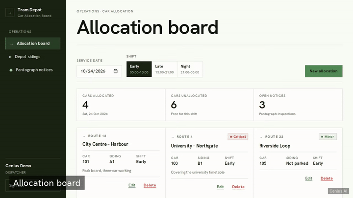
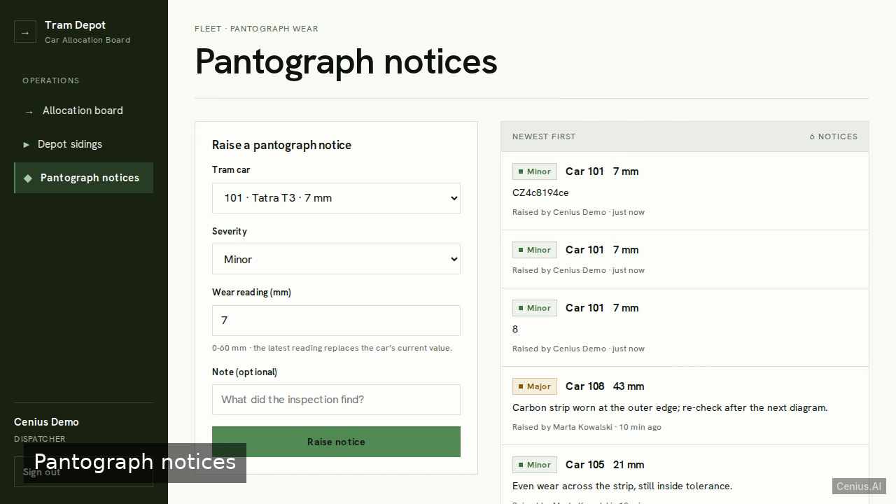

# Tram Depot Car Allocation Board — Node.js monitoring dashboard reference implementation

**Tram Depot Car Allocation Board** is a free, open-source monitoring dashboard written in Node.js. A single-file Node 20 web app (plain `http` server in main.js, zero npm dependencies) that lets tram depot staff sign in and run the day's car allocation board: assign tram cars to routes per shift for a chosen date,…. Every Tram Depot Car Allocation Board file — code, design, seeded demo data — ships in this repository under the Apache-2.0 license. Self-host it, or [remix Tram Depot Car Allocation Board on cenius.ai](https://cenius.ai/marketplace/p/tram-depot-car-allocation-board?ref=gh&utm_campaign=tram-depot-car-allocation-board-nodejs) to get a custom build with full rebrand rights.


[](LICENSE)  [](https://cenius.ai)

[](https://cenius.ai/marketplace/p/tram-depot-car-allocation-board?ref=gh&utm_campaign=tram-depot-car-allocation-board-nodejs)

> **▶ [Open & edit in cenius.ai](https://cenius.ai/marketplace/p/tram-depot-car-allocation-board?ref=gh&utm_campaign=tram-depot-car-allocation-board-nodejs)** — one click to an editable workspace: describe changes in plain English, get an instant preview, one-click deploy and host. Modifications made on the platform come with full rebrand & relicense rights.

_Local clone? See [Quick start](#quick-start) below. cenius.ai is the zero-setup path._

## Demo



▶ **[Video walkthrough](https://cenius.ai/marketplace/p/tram-depot-car-allocation-board?ref=gh&utm_campaign=tram-depot-car-allocation-board-nodejs)** — see the app in action on the cenius.ai project page · [MP4 file](.github/media/demo.mp4)

## Screenshots

  

## Features

- Staff login with a seeded demo account
- Shift allocation board (cars assigned to routes per shift)
- Depot siding track positions
- Pantograph wear inspection notices

## Quick start

```bash
./install.sh   # installs dependencies + seeds demo data
```

See [`INSTALL.md`](INSTALL.md) for full setup and usage instructions.

## Architecture

`install.sh` takes care of packages and initial data in a single pass; nothing else is required before launching. The Node.js codebase (33 files) is self-contained — no external services needed to evaluate it. Top-level layout: `data/`, `public/`, `test/`. Step-by-step setup guide: [`INSTALL.md`](INSTALL.md).

## Usage guide

Sign in at `/login` with the demo account printed on the card
(`cenius@cenius.ai` / `cenius`) or press **Use demo account** to fill the fields.

The left rail is the only navigation: **Allocation board**, **Depot sidings**,
**Pantograph notices**, with the signed-in name and role pinned to the bottom next to
**Sign out**. On narrow screens the rail collapses into a compact bar above the
workspace.

### Allocation board (`/`)

1. Choose a **service date** (defaults to today) and a **shift** — Early (05:00–13:00),
   Late (13:00–21:00) or Night (21:00–05:00). Both reload the board.
2. The counters above the records read *cars allocated*, *cars unallocated* (of the
   10-car fleet) and *open notices*.
3. Each record shows the route code and name, the tram car's fleet number, the siding
   slot the car stands on, and a severity badge when that car has an open pantograph
   notice.
4. **New allocation** opens a form pre-filled with the shift and date you are looking
   at. Pick a route and a car, add an optional note (200 characters) and save. A car
   cannot be put on the same route, shift and date twice — the form says so next to
   the car field.
5. **Edit** reopens the same form for that record; **Delete** asks for confirmation
   before removing it. Both write straight to `data/db.json`, so the change survives a
   reload and a server restart.

### Depot sidings (`/depot`)

Slots are grouped by track (A, B, C). Each row is one slot:

_Full guide: [`USAGE.md`](USAGE.md)_

## FAQ

### What's the quickest way to self-host Tram Depot Car Allocation Board?

It runs entirely on your own machine. Clone, run `./install.sh`, and follow [`INSTALL.md`](INSTALL.md) — the whole stack is in this repo, no external dependencies required.

### Is it OK to ship Tram Depot Car Allocation Board as part of a product?

Yes. The code is Apache-2.0-licensed — use it, modify it, and ship it commercially. See [LICENSE](LICENSE).

### How do I make Tram Depot Car Allocation Board my own brand?

Yes. You can edit the source directly under the MIT license, or [remix it on cenius.ai](https://cenius.ai/marketplace/p/tram-depot-car-allocation-board?ref=gh&utm_campaign=tram-depot-car-allocation-board-nodejs) — the platform route grants full rebrand and relicense rights over your derivative.

### Can non-developers customise Tram Depot Car Allocation Board?

Non-developers can use [cenius.ai](https://cenius.ai/marketplace/p/tram-depot-car-allocation-board?ref=gh&utm_campaign=tram-depot-car-allocation-board-nodejs) to make changes. Describe your goal in everyday language and the platform delivers an updated, ready-to-run project — zero coding on your part.

### Which framework or language does Tram Depot Car Allocation Board use?

Node.js. The full source in this repository is exactly what the app runs. Highlights include staff login with a seeded demo account.

## License & rebranding

Released under the [Apache License 2.0](LICENSE) (© 2026 Cenius AI) — free for personal and commercial use. The Cenius name/logo are trademarks (see NOTICE).

**Need a customized version?** [Remix this app on cenius.ai](https://cenius.ai/marketplace/p/tram-depot-car-allocation-board?ref=gh&utm_campaign=tram-depot-car-allocation-board-nodejs) — modifications made on the platform come with **full rebrand & relicense rights** over your derivative.

## Built with cenius.ai

This entire application — code, design, seeded demo data — was generated on **[cenius.ai](https://cenius.ai)** from a plain-English description.

- 🚀 [Build your own app on cenius.ai](https://cenius.ai)
- 🎛️ [Remix Tram Depot Car Allocation Board on the marketplace](https://cenius.ai/marketplace/p/tram-depot-car-allocation-board?ref=gh&utm_campaign=tram-depot-car-allocation-board-nodejs) — open it in a workspace, prompt for changes, and ship your own version.

More open-source apps: [the Cenius-ai catalog](https://github.com/Cenius-ai) · [showcase index](https://github.com/Cenius-ai/showcase)
